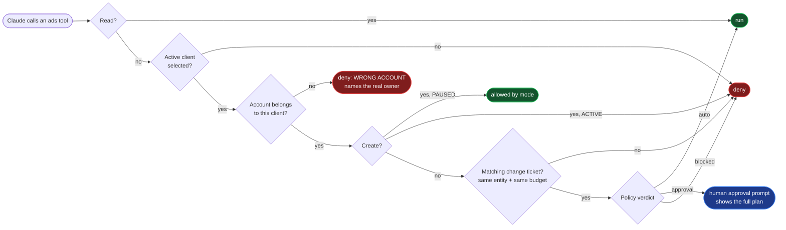
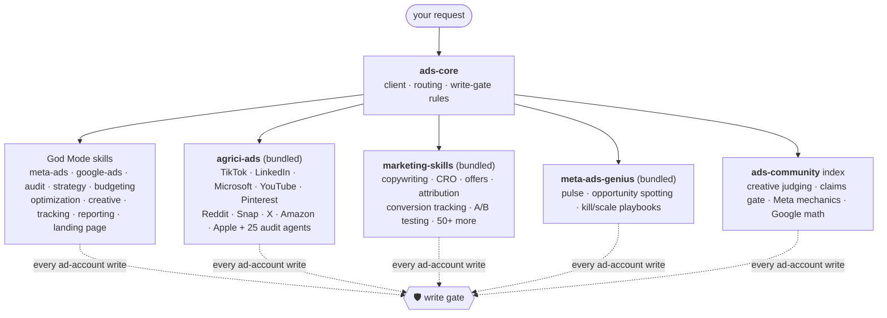
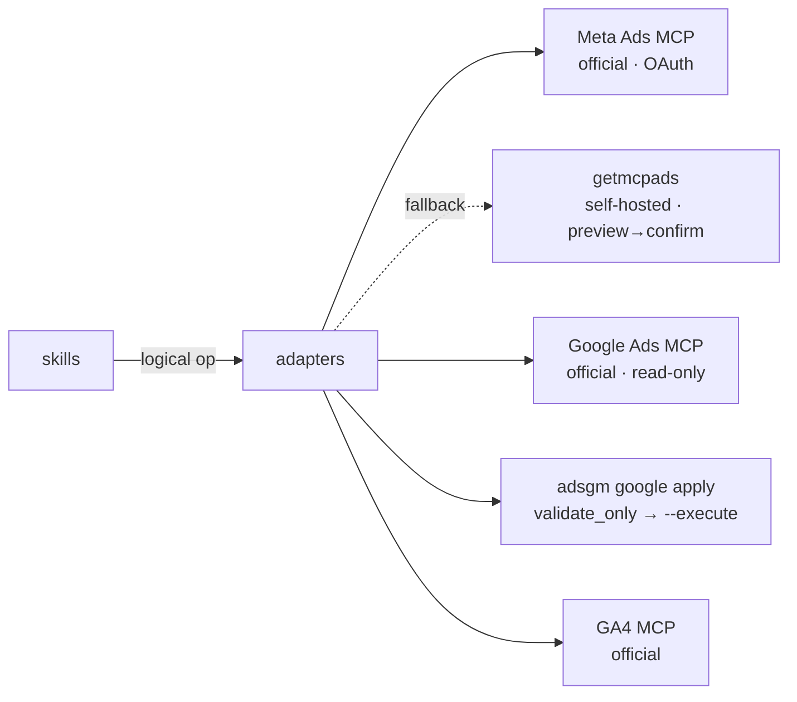

<div align="center">


<br/>

[](https://github.com/F0rger123/claude-meta-ads-god-mode/actions/workflows/ci.yml)
[](LICENSE)
[](#-install-in-60-seconds)
[](connectors/meta/README.md)
[](connectors/google/README.md)
[](#-tests)
[](#-tests)
[](#-the-skill-umbrella)
[](#-install-in-60-seconds)

**Turn Claude into a senior paid-media operator that cannot spend your money by accident.**

[Install](#-install-in-60-seconds) ·
[What you can say](#-just-talk-to-it) ·
[Safety](#-the-write-gate) ·
[Skill umbrella](#-the-skill-umbrella) ·
[Connectors](#-connectors) ·
[Commands](#-commands)

</div>

---

```text
READ FREELY · ANALYZE FREELY · PLAN FREELY · DRAFT FREELY
CREATE PAUSED · WRITE CAREFULLY · SPEND ONLY WITH APPROVAL
```

Most "AI ads" setups give a model an API token and hope for the best. **God Mode** is a full Claude Code plugin that combines three things:

- **knowledge** of how Meta and Google actually deliver ads;
- **adapters** that hide which MCP server does what;
- a **hard write gate**: no write goes through until the client, platform, account and entity are verified, and no spend starts without a human yes.

> [!IMPORTANT]
> No tool can promise ROAS, and this one doesn't. What it does promise: it works from evidence, it labels its confidence, and it checks before every write.

## 💬 Just talk to it

```text
Add D-Hauss Remodeling as a new ads client.
Review D-Hauss ads this week.
Show me what wasted the most spend this month.
Build a York, PA kitchen-remodel lead campaign on Meta at $60/day.
Compare Meta and Google for this client.
Something is overspending on D-Hauss. Stop it.
```

Claude works out the **client, platform, account, objective, campaign, timeframe and conversion goal** on its own. You never touch an MCP tool name.

## ✨ What's inside

<table>
<tr>
<td width="33%" valign="top">

### 🧠 Platform brain
- Meta delivery mechanics: the **breakdown effect**, the **learning phase**, Advantage+, attribution after the 2026 view-window removal
- Google: match types, search terms, Quality Score, impression share, conversion lag
- Every claim is labeled **FACT · BEST PRACTICE · HEURISTIC · EXPERIMENT**

</td>
<td width="33%" valign="top">

### 🛡️ Write gate
- Wrong-account prevention against client profiles
- Everything is **created PAUSED**
- Every write needs a single-use **change ticket**
- 5 automation modes with guarded-auto limits
- Fails closed; every write lands in an audit log

</td>
<td width="33%" valign="top">

### 🔌 Swappable connectors
- Official **Meta Ads MCP** first
- Self-hosted Meta fallback
- Official **Google Ads MCP** for reads
- Validate-first Google writer for writes
- GA4 for analytics, plus slots for any other platform

</td>
</tr>
<tr>
<td valign="top">

### 📊 Operator workflows
Onboarding, audits, launches, optimization cycles, budget reviews, creative testing, competitor research, reporting, emergency stop.

</td>
<td valign="top">

### ☂️ Skill umbrella
**3 companion plugins ship inside**, and they install automatically with God Mode. Together with the vendored community skills, that adds **114 more skills and 26 agents**, covering **10 more ad platforms**. All of it runs under God Mode's rules.

</td>
<td valign="top">

### ✅ Tested
**126 tests**, stdlib only: isolation, routing, gating, budget limits, approvals, secret scanning, license and pin checks, and install wiring.

</td>
</tr>
</table>

## 🛡️ The write gate

Every ad-platform tool call passes through a Claude Code **PreToolUse hook** before it runs. Reads go straight through. Writes have to clear every check:



| Mode (per client) | Runs without asking | Needs your yes | Never |
|---|---|---|---|
| `read_only` | analyze, recommend | emergency pause | anything else |
| `draft` | create PAUSED | pause | activate, budgets, edits |
| **`approval`** *(default)* | create PAUSED | every other write | billing, admin, create ACTIVE |
| `guarded_auto` | small listed changes within limits (e.g. budget ±20%, ≤ $50/day, ≥ 15 conversions, 72 h cooldown) | everything else | billing, admin, create ACTIVE |
| `full_auto` | off unless the operator sets `ADS_GODMODE_ENABLE_FULL_AUTO=1` | activation, deletes, tracking, geo expansion, budget jumps over 50% | billing, admin |

<details>
<summary><b>What a budget change looks like</b></summary>

```text
CLIENT: D-Hauss Remodeling (d-hauss-remodeling) | PLATFORM: meta | ACCOUNT: act_...
CURRENT BUDGET : 50.00 USD (daily)
PROPOSED BUDGET: 60.00 USD (daily)
PERCENT CHANGE : +20.0%
DOLLAR CHANGE  : +10.00 USD
REASON         : CPL $61 vs $90 target for 14 days, spending full budget
DATA           : 14d $700 spend, 11 leads; not in learning
EXPECTED EFFECT: +2-3 leads/week at CPL up to ~$75
RISKS          : marginal CPL rises; may re-enter learning
CONFIDENCE     : MODERATE
```
The write only goes through if its amount matches this plan exactly. That rule works whether the platform takes major units, minor units or micros.
</details>

<details>
<summary><b>What a paused-first launch looks like</b></summary>

```text
You:    Build a Meta campaign for D-Hauss Remodeling targeting homeowners around York, PA
        for kitchen remodel leads at $60/day.
Claude: loads the profile → checks the account and dataset → proposes a strategy
        (Leads, 25 mi radius, Advantage+ placements) → warns that $60/day at a $90 CPL target
        will probably stay learning-limited → builds the campaign, ad set and ads PAUSED
        → shows ids and previews.
You:    Launch it.
Claude: adsgm plan activate … → approval prompt → ads_activate_entity → reads the status back.
```
</details>

Also enforced:
- **No hidden prompts.** In `bypassPermissions`, `dontAsk` or `auto` permission modes, any change that needs approval is denied, because nobody would see the prompt.
- **Fails closed.** A crash inside the gate blocks the write.
- **Redacted audit log.** Every write is recorded with secrets removed.

Full details: [safety model](references/safety-model.md) · [approval matrix](references/approval-model.md).

## ☂️ The skill umbrella

God Mode doesn't try to write everything itself. It **ships strong open-source ad plugins inside the repo**, installs them for you, and puts **its own safety rules on top**.



### What installs automatically

| Bundled plugin | Author | License | Pinned | Brings |
|---|---|---|---|---|
| `agrici-ads` | [AgriciDaniel/claude-ads](https://github.com/AgriciDaniel/claude-ads) | MIT | `fc3908e` | 34 skills + 25 agents for 12 platforms: audits, plans, creative, monitoring |
| `marketing-skills` | [coreyhaines31/marketingskills](https://github.com/coreyhaines31/marketingskills) | MIT | `e85f3cb` | 52 marketing skills: ads, ad creative, copy, CRO, offers, attribution, tracking |
| `meta-ads-genius` | [aaronpdoherty/meta-ads-genius](https://github.com/aaronpdoherty/meta-ads-genius) | MIT | `3fcacc3` | 5 Meta skills + auditor agent |

| Host | How companions arrive |
|---|---|
| **Claude Code** | They are `dependencies` of `ads`, so `claude plugin install ads@claude-meta-ads-god-mode` installs all three. Verified: *"Successfully installed plugin: ads (+ 3 dependencies)"*. |
| **Codex** | Codex has no plugin dependencies, so add the four plugins once (commands below), run `python scripts/install.py --codex --yes` from a clone, or ask Codex to run `/ads:setup`. All four plugins come from this repo's [Codex marketplace](.agents/plugins/marketplace.json). |

### How they are used

`ads-core` tells Claude and Codex **when** to reach for each companion: other platforms, second-opinion audits, copy and CRO, Meta pulse. It also tells them **how**:
- resolve the client first;
- God Mode's rules win;
- any activate, budget or delete instruction from a companion turns into a recommendation that goes through `adsgm plan` and the gate.

### Why bundled instead of linked

Each companion is a text-only copy pinned to a reviewed commit, with its upstream `LICENSE` and a `SOURCE.json`. Before shipping, every file was scanned for prompt-injection phrases, shell pipes, token requests and hidden Unicode. Nothing loads from a live upstream branch.

What's left out: each companion's code and scripts (e.g. claude-ads' Python core, which powers image generation and cockpit publishing). For those features, install the upstream plugin.

**Plus 23 single-file community skills** from mathiaschu, mardab96, itallstartedwithaidea, gooseworks-ai and thaleslaray. They're routed by `ads-community`, so they aren't loaded into every session. **Optional:** `adplane`, a hosted connector that sends account data to Adplane. It is never installed automatically. Details: [community/README.md](community/README.md).

## 🔌 Connectors

Researched across 12+ projects. Full comparison: [references/tool-comparison.md](references/tool-comparison.md).



| Job | Meta | Google |
|---|---|---|
| Reads & reporting | official MCP | official MCP (GAQL) |
| Campaign creation | official MCP, **PAUSED** | bundled writer, **PAUSED** |
| Budgets / status / targeting | official MCP via ticket | bundled writer via ticket |
| Negatives | n/a | bundled writer, preview list first |
| PMax / Display / Video edits | n/a | budget & status only (Claude says so) |

## 🚀 Install in 60 seconds

```bash
claude plugin marketplace add F0rger123/claude-meta-ads-god-mode
claude plugin install ads@claude-meta-ads-god-mode
```

This installs God Mode **plus its 3 bundled companions**. Then, inside Claude Code: `/mcp` → **meta-ads** → sign in with Facebook, then run `/ads:doctor`.

**Codex**

```bash
codex plugin marketplace add F0rger123/claude-meta-ads-god-mode
codex plugin add ads@claude-meta-ads-god-mode
codex plugin add agrici-ads@claude-meta-ads-god-mode
codex plugin add marketing-skills@claude-meta-ads-god-mode
codex plugin add meta-ads-genius@claude-meta-ads-god-mode
```

**Both at once, from a clone:** `python scripts/install.py` (dry run), then `python scripts/install.py --yes`.

> [!NOTE]
> Codex doesn't run Claude Code hooks, so the write gate isn't automatic there. `AGENTS.md` tells Codex to call `hooks/write_gate.py` before every ad write. Keep write-capable connectors off in Codex if you need a hard guarantee.

<details>
<summary><b>Meta setup</b></summary>

1. `/mcp` → `meta-ads` → sign in with the Facebook account that manages the business. Grant `ads_read`. Add `ads_management` only if Claude should draft and make approved changes.
2. If the bundled entry doesn't connect: `claude mcp add --transport http meta-ads https://mcp.facebook.com/ads`.
3. Optional self-hosted fallback: [connectors/meta/README.md](connectors/meta/README.md).
</details>

<details>
<summary><b>Google setup</b></summary>

1. Get a developer token (Explorer access or higher) and a Cloud project with the Google Ads API enabled.
2. Reads: add the official Google Ads MCP. The config is [here](connectors/google/mcp.google-ads.example.json). Keep the server name `google-ads`.
3. Writes: run `pip install -r requirements-google.txt` and set the `GOOGLE_ADS_*` variables privately ([guide](connectors/google/README.md)).
4. Optional GA4: [connectors/analytics/README.md](connectors/analytics/README.md).
</details>

<details>
<summary><b>Environment variables</b></summary>

The official Meta MCP needs **none**. Placeholders are in [.env.example](.env.example). Keep real values in your OS keychain or the MCP server's environment, never in the repo.

| Variable | For |
|---|---|
| `ADS_GODMODE_HOME` | profiles, tickets and audit log (default `~/.ads-godmode`) |
| `ADS_GODMODE_ENABLE_FULL_AUTO` | full-auto opt-in (default off) |
| `META_ACCESS_TOKEN`, `META_ENABLE_WRITES` | self-hosted Meta fallback only |
| `GOOGLE_PROJECT_ID`, `GOOGLE_ADS_DEVELOPER_TOKEN` | Google Ads MCP |
| `GOOGLE_ADS_CLIENT_ID` / `_CLIENT_SECRET` / `_REFRESH_TOKEN` / `_LOGIN_CUSTOMER_ID` | Google writer |
</details>

<details>
<summary><b>Client profiles & account mapping</b></summary>

Each client is a JSON file in `~/.ads-godmode/clients/<slug>.json`, outside the repo. It holds:
- business, offer and service area with geographic limits
- economics: job value, lead value, margin, CPL/CPA/ROAS targets, budget
- Meta account, Page and dataset; Google customer id and conversion actions
- GA4, Search Console, CRM and landing pages
- brand voice and prohibited claims
- approval rules, automation mode and guarded-auto limits

[Template](templates/client-profile.json).

```bash
python adsgm.py clients new d-hauss-remodeling
python adsgm.py clients validate ~/.ads-godmode/clients/d-hauss-remodeling.json
python adsgm.py clients check-isolation   # no account may belong to two clients
python adsgm.py use "D-Hauss"             # active client for writes (expires after 12 h)
```
</details>

## ⌨️ Commands

| | Command | Does |
|---|---|---|
| 🧾 | `/ads:onboard <client>` | build a profile through short question groups; checks every account id with a read |
| 🔍 | `/ads:audit <client>` | severity-ranked findings with evidence, impact, confidence, action and an approval flag |
| 📈 | `/ads:report <client>` | owner summary (spend, results, CPA, ROAS, what won, what lost, what changed, next steps) |
| 🚀 | `/ads:launch <client> <brief>` | strategy, then a full build created PAUSED, shown back; activation waits for your yes |
| ⚙️ | `/ads:optimize <client>` | multi-window analysis; certain vs probable waste; changes graded HIGH / MODERATE / EXPERIMENT |
| 💰 | `/ads:budget <client>` | budget changes with full disclosure and policy limits |
| 🎬 | `/ads:creative <client>` | hooks, retention, fatigue, then structured briefs for your video workflow |
| 🕵️ | `/ads:competitors <client>` | Meta Ad Library and Google Transparency research; never copies ads |
| 📡 | `/ads:tracking <client>` | Pixel, CAPI, conversions, GA4, GTM, UTMs and CRM attribution |
| ⏸️ | `/ads:pause <client> <entities>` | pauses exactly what you named, after verifying it |
| 🚨 | `/ads:emergency-stop <client>` | finds runaway spend, pauses precisely and explains what happened |
| 🧩 | `/ads:setup` | checks the bundled companions in Claude Code and Codex, and installs or repairs them with your OK |
| 🩺 | `/ads:doctor` | checks the setup without printing secrets |

## 🗂️ Repository layout

```text
.claude-plugin/   Claude Code plugin (with dependencies) + marketplace
.codex-plugin/    Codex plugin manifest
.agents/plugins/  Codex marketplace (ads + bundled companions, local paths)
bundles/          bundled companion plugins: agrici-ads · marketing-skills · meta-ads-genius
skills/           ads-core · meta-ads · google-ads · ads-community · 11 task skills
community/        single-file community skills (pinned, licensed) + sources.json for everything vendored
workflows/        10 end-to-end workflows
references/       tool comparison · safety · approval · metrics · attribution · limits · naming
templates/        profiles · briefs · launch plan · reports · experiment log
commands/         /ads:* slash commands
connectors/       adapters · tool registry · Google writer · example MCP configs
godmode/          stdlib safety core + adsgm CLI
hooks/            PreToolUse / PostToolUse write gate
scripts/          install.py (Claude Code + Codex) · sync_community.py (re-vendor pinned commits)
tests/            routing · isolation · gating · budget · approval · hygiene
```

## 🧪 Tests

```bash
python tests/run_all.py   # 126 tests · stdlib only · no network · Google API mocked
```

The suite covers:
- client isolation and wrong-account prevention
- read/write routing, and connector failures that fail closed
- approval enforcement and paused-first creation
- budget safeguards and automation limits
- destructive-action blocking and the emergency stop
- secret scanning, plus license and pin checks on vendored skills and bundles
- dependency and marketplace wiring for Claude Code and Codex

Before any live write, use Google Ads test accounts or a Meta test ad account.

## 🔐 Security · 🤝 Contributing · 📄 License

- **Security:** never commit tokens or client data; prefer official OAuth; keep secrets server-side. See [SECURITY.md](SECURITY.md).
- **Contributing:** safety changes need tests, and knowledge must be labeled and sourced. See [CONTRIBUTING.md](CONTRIBUTING.md).
- **License:** [MIT](LICENSE). Third-party and vendored components are listed in [THIRD_PARTY.md](THIRD_PARTY.md).

<div align="center">
<sub>Independent project · not affiliated with Meta or Google · Meta, Facebook, Instagram, Google Ads and Google Analytics are trademarks of their owners.</sub>
</div>
