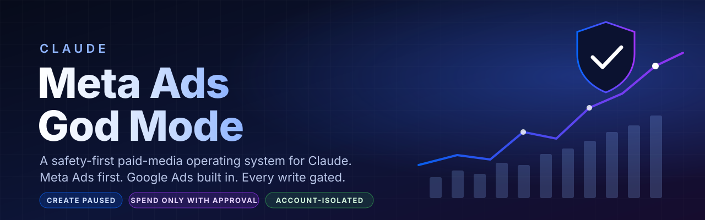
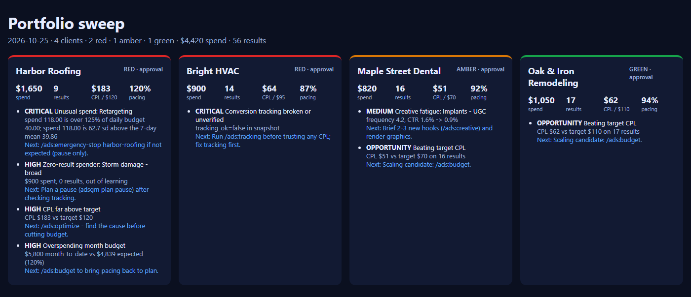
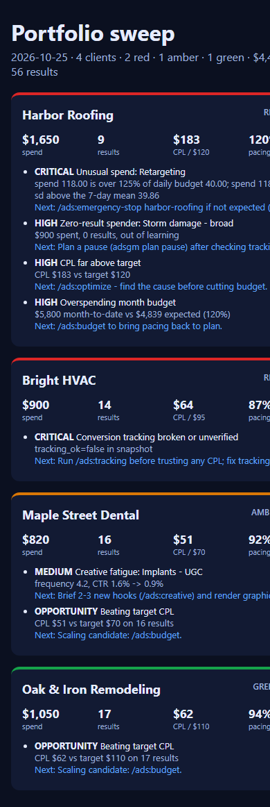
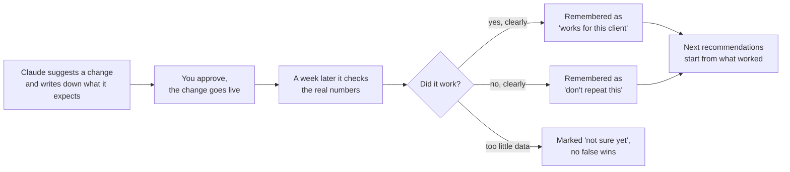
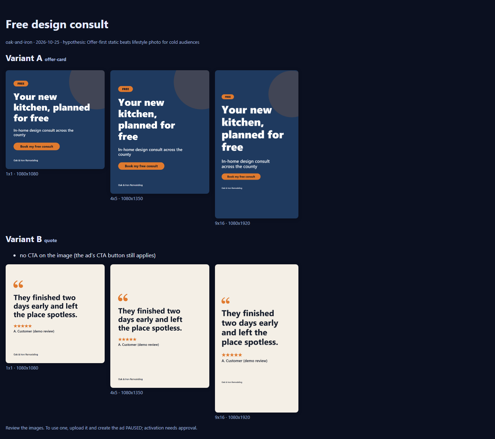
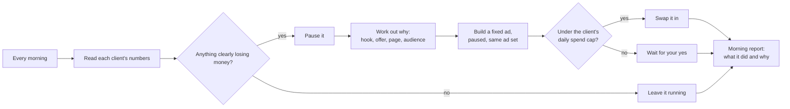
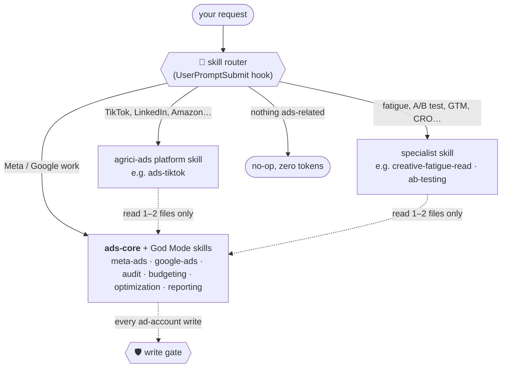
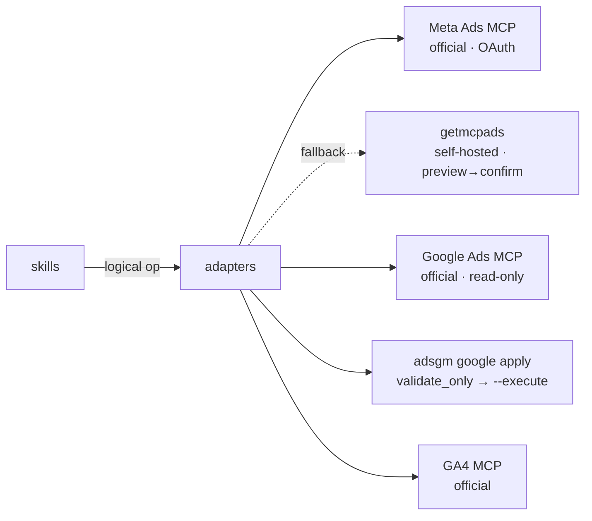

<div align="center">



<br/>

[](https://github.com/F0rger123/claude-meta-ads-god-mode/actions/workflows/ci.yml)
[](LICENSE)
[](#-install-in-60-seconds)
[](connectors/meta/README.md)
[](connectors/google/README.md)
[](#-tests)
[](#-tests)
[](#-the-skill-umbrella)
[](#-install-in-60-seconds)

**Turn Claude into a senior paid-media operator that cannot spend your money by accident.**

[Install](#-install-in-60-seconds) ·
[What you can say](#-just-talk-to-it) ·
[Safety](#-the-write-gate) ·
[Skill umbrella](#-the-skill-umbrella) ·
[Connectors](#-connectors) ·
[Commands](#-commands)

</div>

<p align="center"><a href="https://github.com/F0rger123/claude-business-god-mode"></a></p>

---

```text
READ FREELY · ANALYZE FREELY · PLAN FREELY · DRAFT FREELY
CREATE PAUSED · WRITE CAREFULLY · SPEND ONLY WITH APPROVAL
```

Most "AI ads" setups give a model an API token and hope for the best. **God Mode** is a full Claude Code plugin that combines three things:

- **knowledge** of how Meta and Google actually deliver ads;
- **adapters** that hide which MCP server does what;
- a **hard write gate**: no write goes through until the client, platform, account and entity are verified, and no spend starts without a human yes.

> [!IMPORTANT]
> No tool can promise ROAS, and this one doesn't. What it does promise: it works from evidence, it labels its confidence, and it checks before every write.

> [!IMPORTANT]
> **🤖 AI agents (Claude, ChatGPT, Codex, Cursor, Gemini): start here.** If someone pasted this link and asked you to set it up or explain it, do this before anything else:
> 1. Read the setup wizard: [`docs/SETUP_WIZARD.md`](https://raw.githubusercontent.com/F0rger123/claude-meta-ads-god-mode/main/docs/SETUP_WIZARD.md). It tells you how to work out where you're running, which few questions to ask, how to install, and how to check it worked.
> 2. Read the rules: [`AGENTS.md`](https://raw.githubusercontent.com/F0rger123/claude-meta-ads-god-mode/main/AGENTS.md). Running the plugin starts at [`skills/ads-core/SKILL.md`](https://raw.githubusercontent.com/F0rger123/claude-meta-ads-god-mode/main/skills/ads-core/SKILL.md). Nothing is ever activated or spent without the person's explicit yes.
> 3. Then ask the person the Step 1 questions (platforms, first client, how hands-on), install, connect accounts **read-only first**, and run `/ads:doctor`.
>
> Plain-text index of everything: [`llms.txt`](https://raw.githubusercontent.com/F0rger123/claude-meta-ads-god-mode/main/llms.txt). Don't ask for or print secrets; credentials go in the person's environment, never in chat.

## 💬 Just talk to it

```text
Add D-Hauss Remodeling as a new ads client.
Review D-Hauss ads this week.
Show me what wasted the most spend this month.
Build a York, PA kitchen-remodel lead campaign on Meta at $60/day.
Compare Meta and Google for this client.
Something is overspending on D-Hauss. Stop it.
Review all my clients. Which ones need attention?
What's actually worked for D-Hauss so far?
Make three graphic ads for the free-consult offer.
Run the weekly review every Monday morning.
```

Claude works out the **client, platform, account, objective, campaign, timeframe and conversion goal** on its own. You never touch an MCP tool name.

**Setting up is a conversation.** Paste the repo link into Claude and say *"set this up for my business, Acme Roofing"*. The [setup wizard](docs/SETUP_WIZARD.md) goes one step at a time, with a clickable link for every website step, and waits for your OK before moving on. It covers:

- Meta business, ad account and Page
- billing (you type your card on Meta's page)
- connecting Claude
- Google (optional)
- the client profile and niche research
- a budget plan
- autopilot on or off
- scheduled reports

**Try it in one minute, with no ad accounts:** `python scripts/demo.py` builds four made-up clients. It then runs the all-clients review, the learning report and the graphic ads, so you can see everything below for yourself.

## ✨ What's inside

<table>
<tr>
<td width="33%" valign="top">

### 🧠 Platform brain
- Meta delivery mechanics: the **breakdown effect**, the **learning phase**, Advantage+, attribution after the 2026 view-window removal
- Google: match types, search terms, Quality Score, impression share, conversion lag
- Every claim is labeled **FACT · BEST PRACTICE · HEURISTIC · EXPERIMENT**

</td>
<td width="33%" valign="top">

### 🛡️ Write gate
- Wrong-account prevention against client profiles
- Everything is **created PAUSED**
- Every write needs a single-use **change ticket**
- 5 automation modes with guarded-auto limits
- Fails closed; every write lands in an audit log

</td>
<td width="33%" valign="top">

### 🔌 Swappable connectors
- Official **Meta Ads MCP** first
- Self-hosted Meta fallback
- Official **Google Ads MCP** for reads
- Validate-first Google writer for writes
- GA4 for analytics, plus slots for any other platform

</td>
</tr>
<tr>
<td valign="top">

### 🏢 Agency mode
**Run 10+ clients.** One sweep ranks them all, a learning loop works out what works for each one, scheduled runs send weekly reports, and graphic ads render in each client's brand.

</td>
<td valign="top">

### ☂️ Skill umbrella
**137 community skills and agents ship inside**, covering **10 more ad platforms**. None are preloaded: a router picks the 1–2 a request needs, so they cost no context until used.

</td>
<td valign="top">

### ✅ Tested
**204 tests**, stdlib only: isolation, routing, gating, budget limits, approvals, sweeps, learning, unattended runs, ad rendering, and secret and license checks.

</td>
</tr>
</table>

## 🏢 Agency mode: ten clients, one operator

### How many clients?

As many as you have. Each client gets its own private profile, and work happens **one client at a time**, so data never crosses over:
- **Meta:** one Facebook login with partner access to every client's business shows all their ad accounts.
- **Google:** a manager (MCC) account reaches every client account.
- **The write gate** still checks that each change belongs to the client you're working on.

### Review everyone at once: `/ads:sweep`

Claude reads each client's numbers. It never changes anything during a sweep. It saves a snapshot per client and ranks them all:

| 🔴 Red | 🟠 Amber | 🟢 Green |
|---|---|---|
| broken tracking, runaway spend, big overspend, spend with no results | CPL above target, creative fatigue, learning-limited ad sets | on track, or ready to scale |

Every issue comes with the evidence and the exact next step. A dashboard page saves to `~/.ads-godmode/reports/<date>/`.

<p align="center">


</p>
<p align="center"><sub>Made-up demo clients from <code>scripts/demo.py</code>. No real accounts.</sub></p>

### It learns what works for each client: `/ads:learn`



Example from the demo: *"Keep using a 20% budget step (3/3 worked). Stop broad match (3/3 failed)."*

The learning only shapes **recommendations**. It never loosens your spending limits on its own. Across clients, patterns show up as a hint, without mixing anyone's data.

### Weekly reports on autopilot: `/ads:schedule`

| When | What you get |
|---|---|
| Every morning | Overspend and broken-tracking check across all clients |
| Every Monday | Full review: per-client *what worked · what didn't · fix next*, plus the dashboard |
| 1st of the month | An owner-friendly monthly report per client |

Scheduled runs are **read-only by default**:
- Fixes they find wait in the report for your yes.
- A client can opt in to small automatic tweaks within its limits.
- Nothing that needs approval ever runs unattended.

It uses the Claude desktop app's scheduler when available, otherwise Windows Task Scheduler or cron.

### Graphic ads in each client's brand

`adsgm creative render` turns a brief into finished static ads. There are four layouts (offer card, photo with headline, review quote, before/after) in four sizes (square, 4:5, Stories/Reels with safe zones, and wide link ads), all in the client's colors, font and logo.

It refuses banned claims, works only from real client photos and reviews, and costs nothing to run, with no AI image service involved. Anything you use goes into the ad account **paused**.

<p align="center"></p>

### Budget plans: how much, daily or monthly

`/ads:budget-plan` turns *"I have $3,000 a month"* or *"what should I spend?"* into a recommendation with the math shown:
- **Budget type.** Daily for always-on. A lifetime budget per month if the month is a hard ceiling. A flight budget for promotions.
- **What it buys.** Leads per month at the target cost per lead.
- **Learning.** Whether the budget can teach Meta's algorithm, or should stay as one ad set.
- **Starting platform.** Whether to start Google-first.
- **Spend more or less.** Whether to spend a bit more (*"+$25/day ≈ 8 more leads ≈ 1 more job a month"*), or why not to.

### Autopilot: on or off, per client

You set a daily spend cap, and autopilot handles the day-to-day fixes on its own:
- pauses ads that clearly lose money;
- diagnoses why;
- builds a fixed version and swaps it in, in the same ad set;
- on Google, blocks a few wasted searches.

It runs every morning if you schedule it. It never launches new campaigns, raises budgets, changes locations, touches tracking or billing, or deletes anything. Those still need your yes. Switch it with `/ads:autopilot <client> on|off`, and the setup interview always asks.



### Niche research before you spend

`/ads:research <client>` builds a reusable playbook for the niche (roofing, dental, med-spa...):
- typical cost per lead, **conversion rate** and click-through rate, each with its source and date;
- offers and hooks that work;
- competitors' ads;
- seasonality;
- which platform fits.

Every client in the same niche makes the playbook smarter, through tactic win rates, without sharing anyone's data.

### What it won't do

**It won't type your card or passwords.** You add the payment method yourself on Meta's or Google's billing page, and setup links you straight there. From then on the platforms charge it automatically as ads run. God Mode plans and controls the budgets, watches spend against them, and flags overspend or failed payments. Sign-ins happen in your own browser.

## 🛡️ The write gate

Every ad-platform tool call passes through a Claude Code **PreToolUse hook** before it runs. Reads go straight through. Writes have to clear every check:


| Mode (per client) | Runs without asking | Needs your yes | Never |
|---|---|---|---|
| `read_only` | analyze, recommend | emergency pause | anything else |
| `draft` | create PAUSED | pause | activate, budgets, edits |
| **`approval`** *(default)* | create PAUSED | every other write | billing, admin, create ACTIVE |
| `guarded_auto` | small listed changes within limits (e.g. budget ±20%, ≤ $50/day, ≥ 15 conversions, 72 h cooldown) | everything else | billing, admin, create ACTIVE |
| `full_auto` | off unless the operator sets `ADS_GODMODE_ENABLE_FULL_AUTO=1` | activation, deletes, tracking, geo expansion, budget jumps over 50% | billing, admin |

<details>
<summary><b>What a budget change looks like</b></summary>

```text
CLIENT: D-Hauss Remodeling (d-hauss-remodeling) | PLATFORM: meta | ACCOUNT: act_...
CURRENT BUDGET : 50.00 USD (daily)
PROPOSED BUDGET: 60.00 USD (daily)
PERCENT CHANGE : +20.0%
DOLLAR CHANGE  : +10.00 USD
REASON         : CPL $61 vs $90 target for 14 days, spending full budget
DATA           : 14d $700 spend, 11 leads; not in learning
EXPECTED EFFECT: +2-3 leads/week at CPL up to ~$75
RISKS          : marginal CPL rises; may re-enter learning
CONFIDENCE     : MODERATE
```
The write only goes through if its amount matches this plan exactly. That rule works whether the platform takes major units, minor units or micros.
</details>

<details>
<summary><b>What a paused-first launch looks like</b></summary>

```text
You:    Build a Meta campaign for D-Hauss Remodeling targeting homeowners around York, PA
        for kitchen remodel leads at $60/day.
Claude: loads the profile → checks the account and dataset → proposes a strategy
        (Leads, 25 mi radius, Advantage+ placements) → warns that $60/day at a $90 CPL target
        will probably stay learning-limited → builds the campaign, ad set and ads PAUSED
        → shows ids and previews.
You:    Launch it.
Claude: adsgm plan activate … → approval prompt → ads_activate_entity → reads the status back.
```
</details>

Also enforced:
- **No hidden prompts.** In `bypassPermissions`, `dontAsk` or `auto` permission modes, any change that needs approval is denied, because nobody would see the prompt.
- **Fails closed.** A crash inside the gate blocks the write.
- **Redacted audit log.** Every write is recorded with secrets removed.

Full details: [safety model](references/safety-model.md) · [approval matrix](references/approval-model.md).

## ☂️ The skill umbrella

God Mode doesn't try to write everything itself. It **ships 137 open-source ad skills and agents inside the repo**, picks the right ones **automatically for each request**, and puts **its own safety rules on top**.



### How it picks: zero context until needed

Loading every companion as a normal skill would add **~17k tokens to every session**. Of that, ~10k is marketing-skills alone, which is mostly non-ads material like SEO, SMS and churn. Instead, God Mode routes on demand at three levels:

1. **The prompt hook.** It matches your request against [routing rules](community/router_rules.json) and tells Claude which **one or two** bundled `SKILL.md` files to read. Unrelated prompts get no output at all.
2. **The `ads-community` skill.** It holds 30 curated picks plus a searchable [catalog](skills/ads-community/catalog.md) of all 137 entries, so Claude can choose by hand when no rule matched.
3. **The core routing table.** `ads-core` lists when a companion beats God Mode's own skill: other platforms, specialist reads, or a second opinion.

Tested live in Claude Code:

| Prompt | What was read |
|---|---|
| *"Audit my TikTok ads for Spark Ads and Smart+ issues"* | `bundles/agrici-ads/skills/ads-tiktok/SKILL.md` |
| *"Is my best Meta video ad fatigued, or did the audience shrink?"* | `ads-core`, `meta-ads`, `ads-creative-analysis` and `community/vendor/ad-creative-skills/creative-fatigue-read-ad-creative/SKILL.md` |

Before the hook existed, Claude missed the TikTok skill. On machines with many plugins, Claude Code drops skill descriptions to fit its listing budget, so a description alone wasn't enough.

### What's inside

| Source | Author | License | Pinned | Brings |
|---|---|---|---|---|
| `agrici-ads` | [AgriciDaniel/claude-ads](https://github.com/AgriciDaniel/claude-ads) | MIT | `fc3908e` | 33 skills + 23 agents for 12 platforms: audits, plans, creative, monitoring |
| `marketing-skills` | [coreyhaines31/marketingskills](https://github.com/coreyhaines31/marketingskills) | MIT | `e85f3cb` | 52 skills: ads, ad creative, copy, CRO, offers, attribution, tracking (plus non-ads marketing) |
| `meta-ads-genius` | [aaronpdoherty/meta-ads-genius](https://github.com/aaronpdoherty/meta-ads-genius) | MIT | `3fcacc3` | 5 Meta skills + auditor agent |
| 5 smaller sources | mathiaschu · mardab96 · itallstartedwithaidea · gooseworks-ai · thaleslaray | MIT / Apache-2.0 | pinned | 23 skills: creative judging, claims gate, Meta mechanics, Google math |

Every rule is the same whichever skill is in use:
- resolve the client first;
- God Mode's rules win;
- any activate, budget or delete instruction from a community skill turns into a recommendation that goes through `adsgm plan` and the gate.

<details>
<summary><b>Native mode (optional): always-loaded companion plugins</b></summary>

Some users want companion skills to show up as normal slash-skills. Each bundle is also a full Claude Code and Codex plugin, served from this repo:

```bash
python scripts/install.py --native          # dry run
python scripts/install.py --native --yes    # +~17k tokens per session
```
Or run `/ads:setup native`. The router keeps working either way.
</details>

### Why bundled instead of linked

Each companion is a text-only copy pinned to a reviewed commit, with its upstream `LICENSE` and a `SOURCE.json`. Before shipping, every file was scanned for prompt-injection phrases, shell pipes, token requests and hidden Unicode. Nothing loads from a live upstream branch.

What's left out: each companion's code and scripts (e.g. claude-ads' Python core, which powers image generation and cockpit publishing). For those features, install the upstream plugin.

**Optional:** `adplane`, a hosted connector that sends account data to Adplane. It is never installed automatically. Details: [community/README.md](community/README.md).

## 🔌 Connectors

Researched across 12+ projects. Full comparison: [references/tool-comparison.md](references/tool-comparison.md).



| Job | Meta | Google |
|---|---|---|
| Reads & reporting | official MCP | official MCP (GAQL) |
| Campaign creation | official MCP, **PAUSED** | bundled writer, **PAUSED** |
| Budgets / status / targeting | official MCP via ticket | bundled writer via ticket |
| Negatives | n/a | bundled writer, preview list first |
| PMax / Display / Video edits | n/a | budget & status only (Claude says so) |

## 🚀 Install in 60 seconds

```bash
claude plugin marketplace add F0rger123/claude-meta-ads-god-mode
claude plugin install ads@claude-meta-ads-god-mode
```

That installs God Mode with all 137 community skills on board. They're routed on demand, so nothing extra is preloaded. Then, inside Claude Code: `/mcp` → **meta-ads** → sign in with Facebook, then run `/ads:doctor`.

**Browser chat (claude.ai)**:
- Download `meta-ads-god-mode-chat.zip` from [Releases](https://github.com/F0rger123/claude-meta-ads-god-mode/releases/latest) and upload it under **Settings → Capabilities → Skills**.
- Add Meta's connector under [Settings → Connectors](https://claude.ai/settings/connectors), with the URL `https://mcp.facebook.com/ads`.

The chat edition walks setup, budgets, research, audits and paused builds, asking for a typed **yes** before every change. Autopilot, schedules and the safety gate need Claude Code.

**Codex**

```bash
codex plugin marketplace add F0rger123/claude-meta-ads-god-mode
codex plugin add ads@claude-meta-ads-god-mode
```

**From a clone, both hosts:** `python scripts/install.py` (dry run), then `python scripts/install.py --yes`.

> [!NOTE]
> Codex doesn't run Claude Code hooks, so two things work differently there:
> - **The write gate isn't automatic.** `AGENTS.md` tells Codex to call `hooks/write_gate.py` before every ad write. Keep write-capable connectors off in Codex if you need a hard guarantee.
> - **There is no prompt router.** Codex picks community skills through the `ads-community` skill and its catalog instead.

<details>
<summary><b>Meta setup</b></summary>

1. `/mcp` → `meta-ads` → sign in with the Facebook account that manages the business. Grant `ads_read`. Add `ads_management` only if Claude should draft and make approved changes.
2. If the bundled entry doesn't connect: `claude mcp add --transport http meta-ads https://mcp.facebook.com/ads`.
3. Optional self-hosted fallback: [connectors/meta/README.md](connectors/meta/README.md).
</details>

<details>
<summary><b>Google setup</b></summary>

1. Create a Google Cloud project, enable the Google Ads API, and request Explorer or Basic access on the [Google Ads API overview page](https://console.cloud.google.com/google/ads-apis/overview). Developer tokens were retired on 2026-09-09; access now belongs to the Cloud project. Step-by-step links are in the [setup wizard](docs/SETUP_WIZARD.md).
2. Reads: add the official Google Ads MCP. The config is [here](connectors/google/mcp.google-ads.example.json). Keep the server name `google-ads`.
3. Writes: run `pip install -r requirements-google.txt` and set the `GOOGLE_ADS_*` variables privately ([guide](connectors/google/README.md)).
4. Optional GA4: [connectors/analytics/README.md](connectors/analytics/README.md).
</details>

<details>
<summary><b>Environment variables</b></summary>

The official Meta MCP needs **none**. Placeholders are in [.env.example](.env.example). Keep real values in your OS keychain or the MCP server's environment, never in the repo.

| Variable | For |
|---|---|
| `ADS_GODMODE_HOME` | profiles, tickets and audit log (default `~/.ads-godmode`) |
| `ADS_GODMODE_ENABLE_FULL_AUTO` | full-auto opt-in (default off) |
| `META_ACCESS_TOKEN`, `META_ENABLE_WRITES` | self-hosted Meta fallback only |
| `GOOGLE_PROJECT_ID` | Google Ads MCP (developer tokens retired 2026-09-09) |
| `GOOGLE_ADS_CLIENT_ID` / `_CLIENT_SECRET` / `_REFRESH_TOKEN` / `_LOGIN_CUSTOMER_ID` | Google writer |
</details>

<details>
<summary><b>Client profiles & account mapping</b></summary>

Each client is a JSON file in `~/.ads-godmode/clients/<slug>.json`, outside the repo. It holds:
- business, offer and service area with geographic limits
- economics: job value, lead value, margin, CPL/CPA/ROAS targets, budget
- Meta account, Page and dataset; Google customer id and conversion actions
- GA4, Search Console, CRM and landing pages
- brand voice and prohibited claims
- approval rules, automation mode and guarded-auto limits

[Template](templates/client-profile.json).

```bash
python adsgm.py clients new d-hauss-remodeling
python adsgm.py clients validate ~/.ads-godmode/clients/d-hauss-remodeling.json
python adsgm.py clients check-isolation   # no account may belong to two clients
python adsgm.py use "D-Hauss"             # active client for writes (expires after 12 h)
```
</details>

## ⌨️ Commands

| | Command | Does |
|---|---|---|
| 🧾 | `/ads:onboard <client>` | build a profile through short question groups; checks every account id with a read |
| 🔍 | `/ads:audit <client>` | severity-ranked findings with evidence, impact, confidence, action and an approval flag |
| 📈 | `/ads:report <client>` | owner summary (spend, results, CPA, ROAS, what won, what lost, what changed, next steps) |
| 🚀 | `/ads:launch <client> <brief>` | strategy, then a full build created PAUSED, shown back; activation waits for your yes |
| ⚙️ | `/ads:optimize <client>` | multi-window analysis; certain vs probable waste; changes graded HIGH / MODERATE / EXPERIMENT |
| 💰 | `/ads:budget <client>` | budget changes with full disclosure and policy limits |
| 🎬 | `/ads:creative <client>` | hooks, retention and fatigue, briefs for your video workflow, and graphic ads rendered in the client's brand |
| 🕵️ | `/ads:competitors <client>` | Meta Ad Library and Google Transparency research; never copies ads |
| 📡 | `/ads:tracking <client>` | Pixel, CAPI, conversions, GA4, GTM, UTMs and CRM attribution |
| ⏸️ | `/ads:pause <client> <entities>` | pauses exactly what you named, after verifying it |
| 🚨 | `/ads:emergency-stop <client>` | finds runaway spend, pauses precisely and explains what happened |
| 🧩 | `/ads:setup` | checks the install in Claude Code and Codex; can add companions as always-loaded plugins (native mode) |
| 🤖 | `/ads:autopilot <client> [on\|off\|status\|run]` | hands-off fixes inside a daily spend cap: pause losers, fix and relaunch, Google negatives |
| 💵 | `/ads:budget-plan <client>` | how much to spend, daily vs monthly vs flight, Meta/Google split, spend-more math |
| 🔬 | `/ads:research <client>` | niche playbook: sourced benchmarks, conversion rates, offers, hooks, competitors |
| 🏢 | `/ads:sweep [daily\|weekly\|monthly]` | reviews every client at once, ranks them red/amber/green, writes the dashboard |
| 🧠 | `/ads:learn [client]` | judges past changes; shows what works and what doesn't per client |
| ⏰ | `/ads:schedule` | daily, weekly and monthly unattended runs (read-only by default) |
| 🩺 | `/ads:doctor` | checks the setup without printing secrets |

## 🗂️ Repository layout

```text
.claude-plugin/   Claude Code plugin + marketplace (bundles listed for optional native install)
.codex-plugin/    Codex plugin manifest
.agents/plugins/  Codex marketplace (ads + bundled companions, local paths)
bundles/          bundled companion plugins (routed on demand; optional native install)
skills/           ads-core · meta-ads · google-ads · ads-portfolio · ads-community · 11 task skills
community/        single-file community skills (pinned, licensed) + sources.json for everything vendored
workflows/        16 end-to-end workflows (incl. sweep, learning, schedules, graphic ads, autopilot, niche research)
references/       tool comparison · safety · approval · metrics · attribution · limits · naming
templates/        profiles · briefs · launch plan · reports · experiment log
commands/         /ads:* slash commands
connectors/       adapters · tool registry · Google writer · example MCP configs
godmode/          stdlib core + adsgm CLI: safety gate, sweeps, learning loop, schedules, ad renderer
hooks/            write gate (PreToolUse/PostToolUse) · skill router (UserPromptSubmit)
scripts/          demo.py (try it with made-up clients) · install.py · sync_community.py · build_catalog.py
tests/            routing · isolation · gating · budget · approval · hygiene
```

## 🧪 Tests

```bash
python tests/run_all.py   # 204 tests · stdlib only · no network · Google API mocked
```

The suite covers:
- client isolation and wrong-account prevention
- read/write routing, and connector failures that fail closed
- approval enforcement and paused-first creation
- budget safeguards and automation limits
- destructive-action blocking and the emergency stop
- secret scanning, plus license and pin checks on vendored skills and bundles
- the skill router (prompt to skill choices) and marketplace wiring for Claude Code and Codex

**Real-session check:** `python tests/e2e/run_e2e.py` starts real Claude Code sessions against a fake Meta server and confirms the gate does the following:
- allows a paused create in the client's own account;
- blocks another client's account;
- blocks creating something ACTIVE;
- blocks activation without a plan;
- blocks changes that need approval when nobody can approve;
- lets autopilot pauses through;
- passes reads through.

Last run: 7/7. CI also builds real Google Ads API requests with Google's own client library.

Before any live write, use Google Ads test accounts or a Meta test ad account.

## 👑 Part of Claude Business God Mode

This repo is one of four parts of **[Claude Business God Mode](https://github.com/F0rger123/claude-business-god-mode)**, one umbrella that runs a whole
business with Claude: a shared business profile, launch and growth playbooks, and one marketplace that installs
every plugin. Here, ads send leads into the CRM and use finished reels from Video God Mode as creatives.

| Part | What it does |
|---|---|
| [📇 Ultimate CRM Template](https://github.com/F0rger123/ultimate-crm-template) | leads, jobs, invoices, payments, portals |
| [📣 Meta Ads God Mode](https://github.com/F0rger123/claude-meta-ads-god-mode) | paid media, paused-first, approval-gated · **this repo** |
| [🔎 SEO God Mode](https://github.com/F0rger123/CLAUDE-SEO-GOD-MODE) | audits, local SEO, Search Console, AI search |
| [🎬 Video Editing God Mode](https://github.com/F0rger123/claude-video-editing-god-mode) | reels, Shorts, ad creatives, approval PWA |

```text
/plugin marketplace add F0rger123/claude-business-god-mode
```

## 🔐 Security · 🤝 Contributing · 📄 License

- **Security:** never commit tokens or client data; prefer official OAuth; keep secrets server-side. See [SECURITY.md](SECURITY.md).
- **Contributing:** safety changes need tests, and knowledge must be labeled and sourced. See [CONTRIBUTING.md](CONTRIBUTING.md).
- **License:** [MIT](LICENSE). Third-party and vendored components are listed in [THIRD_PARTY.md](THIRD_PARTY.md).

<div align="center">
<sub>Independent project · not affiliated with Meta or Google · Meta, Facebook, Instagram, Google Ads and Google Analytics are trademarks of their owners.</sub>
</div>
